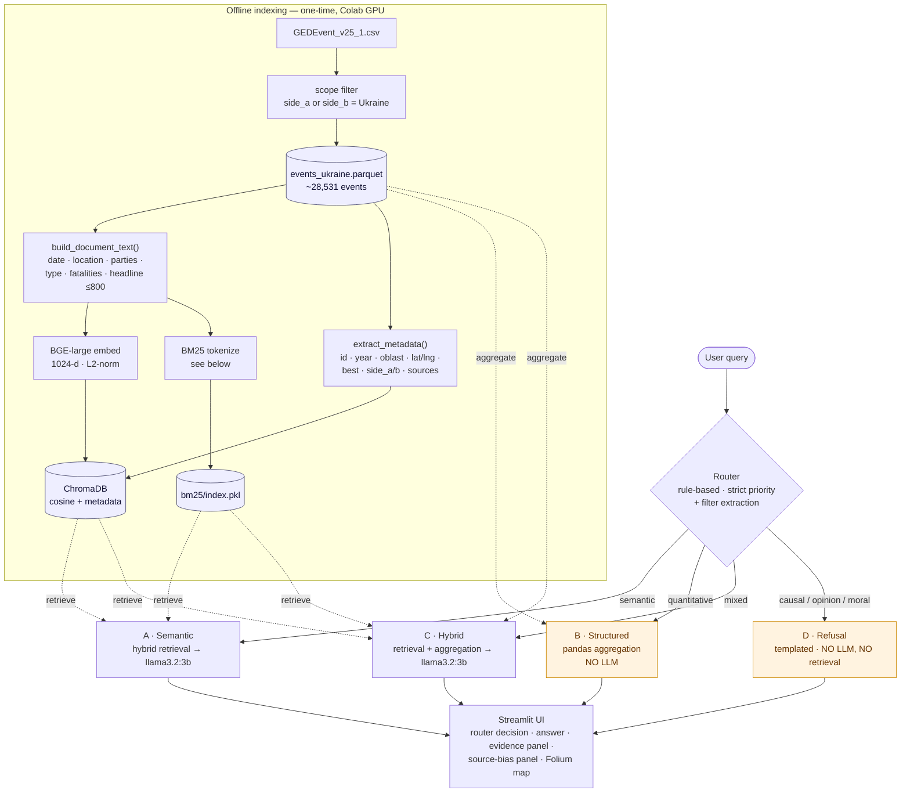
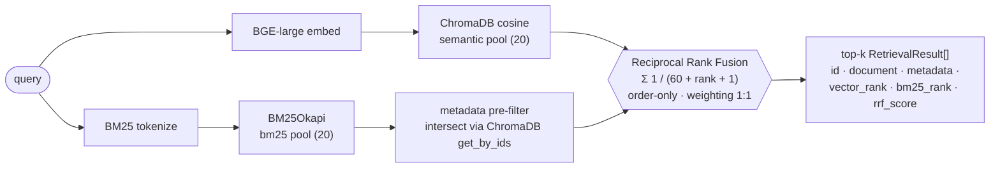

# rag-ucdp

> Hybrid RAG over the UCDP Georeferenced Event Dataset, with rule-based query routing, source-bias surfacing, and geospatial visualization. Scoped to the Ukraine conflict (2022+, ~28,531 events) and designed for a human-rights NGO context where transparency and auditability are non-negotiable.

[](#tests) [](#prerequisites) [](#license) [](#data-and-citations)

---

## What it does

The UCDP Georeferenced Event Dataset is primarily **structured**: every conflict event carries date, coordinates, conflict parties, fatality counts, and categorical fields, all queryable by filter-and-aggregate. What that access pattern *cannot* reach is the **unstructured** `source_headline` field — the news-article text describing named buildings, weapon types, and circumstances that no structured column records.

This project makes that text **semantically searchable**, so an analyst can ask *"attacks on schools,"* *"missile strikes on power infrastructure,"* or *"events near religious sites"* and recover relevant events the columns alone could never surface — while still answering numeric questions (*"how many fatalities in Donetsk in 2023?"*) by **exact aggregation**, not LLM guessing. A four-path router decides which question is which, so the LLM is used **only where LLMs are actually strong**.

Three features take it beyond a vanilla single-corpus RAG demo:

1. **Query routing** — a four-path rule-based router: semantic → hybrid retrieval + LLM; quantitative → pandas aggregation (no LLM); mixed → hybrid; causal/opinion/moral → templated refusal.
2. **Source-bias surfacing** (an NGO requirement) — every result set shows per-affiliation counts, a Simpson diversity index, and a single-affiliation dominance flag. Bias is exposed for the reader, not hidden behind an LLM summary.
3. **Geospatial visualization** (an NGO requirement) — Folium maps overlay retrieved events on Ukrainian territory, making spatial context and cross-border events (Kursk, Belgorod, Poland) visible at a glance.


### Headline metrics (stress-inclusive baseline, v003 — struct = v006)

| Track | Metric | Test set |
|---|---|---|
| Router | accuracy 0.840 · macro-F1 0.852 | n=50 |
| Structured | **30/30** exact-match (all canonicalization bugs fixed) | n=30 |
| Retrieval (hybrid) | HR@10 0.867 · MRR@10 0.622 · set-Recall@10 0.686 · Recall@25 0.827 | n=30 |
| Generation | mean SAS 0.715 · citation faithfulness 1.00 · 0% Poor | n=20 |

These are the **honest, stress-inclusive** numbers. A smaller curated set scores higher (router 0.975, retrieval HR@10 0.95, SAS 0.775); the gap between curated and stress is intentional and analyzed in [`evals/RESULTS_CHANGELOG.md`](./evals/RESULTS_CHANGELOG.md).

### Central analytical finding

For *"civilians killed while sheltering,"* of 21 corpus events mentioning sheltering-related terms, exactly **1** appears in the top-15 retrieved → **effective recall ≈ 5%**. The headlines describe the *event* ("attack on the theater killed 600 civilians"), not the *act* of sheltering. This generalizes into an **anchor-token theory** of when hybrid retrieval succeeds vs fails, which predicted 11 of 12 outcomes on an extended paraphrased test set. Full write-up in [`notes/anchor-token-finding.md`](./notes/anchor-token-finding.md).

### Stack

BGE-large-en-v1.5 (1024-d, MTEB-top-ranked) · ChromaDB (PersistentClient, cosine) · `rank_bm25` (BM25Okapi) · Reciprocal Rank Fusion (k=60) · llama3.2:3b via Ollama (local, CPU-friendly) · pandas + pyarrow · Streamlit · Folium · Python 3.12 / uv / ruff / mypy / pytest.

---

## Architecture

### End-to-end flow



### Hybrid retrieval internals (paths A & C)



The same ChromaDB-style `where` dict drives `vector_store.query`, the BM25 metadata intersection, and `structured_query.apply_filters` — **one filter shape, three execution engines**, so filter semantics are identical across dense, sparse, and structured paths.

### BM25 tokenization — what ships vs what was tested

The lexical branch is a deliberately minimal baseline. Lowercasing and regex tokenization are the only preprocessing in production; every other standard lever was tested as a single-knob experiment and **not adopted** (full numbers in [`evals/RESULTS_CHANGELOG.md`](./evals/RESULTS_CHANGELOG.md)).


| Lever | Status | Verdict |
|---|---|---|
| Lowercasing | ✅ adopted (baseline) | standard; index/query symmetric |
| Regex tokenize `[a-z0-9]+` | ✅ adopted (baseline) | simple, transparent, fast |
| Snowball stemming | tested (v004) | not adopted — net-negative at k=10; broadens matches but deeper, and nudges top-rank hits down |
| Stopword removal | tested (v004) | not adopted — redundant with BM25's IDF term, which already down-weights high-document-frequency tokens |
| Alias canonicalization | tested (v006) | not adopted **for BM25** — UCDP records already carry both spellings in the same event, so folding adds no matches and slightly perturbs scores. *Adopted for the router*, where it fixes oblast filters (structured 30/30). |

Flags for stemming, stopword removal, and canonicalization remain in `bm25_index.py` (off by default), persisted on the index so index-time and query-time tokenization stay symmetric — useful for future NGO data that may lack UCDP's spelling redundancy.

### Router (strict priority — first match wins)

```
1. REFUSAL keywords present              → Path D (Refusal)
2. AGGREGATION keywords present
     2a. AND semantic concept present    → Path C (Hybrid)
     2b. else                            → Path B (Structured)
3. default                               → Path A (Semantic)
```

Keyword lists are exhaustive and inline in `router.py` so behavior is fully predictable. Filter extraction (year / country / oblast, via a shared canonicalization layer) runs independently of the path choice.

For full keyword lists, the affiliation taxonomy, configuration schema, and component-level detail, see [`PROJECT_SUMMARY_UCDP.md`](./PROJECT_SUMMARY_UCDP.md).


## Quick start

### Prerequisites

- Python 3.12
- [`uv`](https://github.com/astral-sh/uv) for dependency management
- [Ollama](https://ollama.com) running locally with the `llama3.2:3b` model pulled

```bash
ollama pull llama3.2:3b
ollama serve
```

### Installation

```bash
git clone https://github.com/floew2/rag-ucdp.git
cd rag-ucdp
uv sync
```

### Data and indexing

The UCDP GED v25.1 CSV must be downloaded separately from [ucdp.uu.se/downloads](https://ucdp.uu.se/downloads) (license redistribution constraints) and placed at `data/raw/GEDEvent_v25_1.csv`. The Ukraine-scoped parquet (`data/processed/events_ukraine.parquet`, 3.6 MB) is committed for reproducibility.

Building the ChromaDB + BM25 indexes on Intel Mac CPU is slow (BGE-large's full-corpus embedding needs ~13 GB and OOMs on macOS MPS), so the recommended path is a one-time Colab GPU build:

```bash
# Open notebooks/colab_indexing.ipynb in Google Colab (T4 GPU, ~1 min),
# download the resulting zip, and extract into:
#   data/chroma_db/
#   data/bm25/index.pkl
```

Both directories are gitignored. The runtime app only embeds **query strings**, which is fast on CPU.

### Running

```bash
uv run streamlit run app/streamlit_app.py               # demo UI
uv run jupyter notebook notebooks/11_evaluation.ipynb   # four-track eval + ablations
```

### Tests

```bash
uv run pytest                        # full suite (195 tests, <15 s)
uv run pytest tests/test_router.py   # a single file
```

---

## Evaluation

The evaluation is the project's analytical core. Each router path gets its own track, and each test set has **two tiers**: a curated set (representative use cases) and a stress extension (failure-mode probes). Reporting only curated numbers overstates robustness; reporting only stress numbers understates baseline capability — so both are reported, with the gap analyzed.

From **v003** onward the evaluation doubles as a **single-knob ablation log**: each later version changes exactly one knob against the v003 baseline, so any metric movement is attributable. The full per-version detail (setup, deltas, mechanisms, verdicts) lives in [`evals/RESULTS_CHANGELOG.md`](./evals/RESULTS_CHANGELOG.md).

### Ablation summary — effective top-10 retrieval (Δ vs v003, n=30)

| version | knob changed | HR@10 | MRR@10 | Rec@10 | verdict |
|---|---|---|---|---|---|
| **v003** | vanilla baseline (hybrid) | 0.867 | 0.622 | 0.686 | reference |
| v004 | BM25 stemming + stopword removal | 0.833 | 0.604 | 0.666 | not adopted (net-negative) |
| v005 | weighted RRF (sweep) | 0.867 | 0.622 | 0.686 | not adopted (1:1 is best) |
| v006 | alias canonicalization | 0.867 | 0.622 | 0.677 | **router fix adopted** (structured 28→30/30); BM25 alias index not adopted |
| v007 | + cross-encoder rerank (MiniLM) | 0.833 | 0.653 | 0.655 | not adopted (paraphrase regressed) |
| v008 | + cross-encoder rerank (BGE) | 0.833 | 0.571 | 0.573 | not adopted (stronger model is worse) |

**No experiment improved headline retrieval over v003.** The one adopted change in the series is the v006 router canonicalization fix (a structured-track correctness fix, not a retrieval gain). Two notable negative results:

- **Weighted RRF (v005)** — equal weight 1:1 is optimal here, which *contradicts* the Gutenberg precursor (where 2:1 semantic won). The optimum is corpus-dependent: UCDP's BM25 leg, though weaker solo, contributes unique high-precision hits on proper-noun queries (Mariupol, Kerch, Przewodów) that any down-weighting discards.
- **Cross-encoder reranking (v007/v008)** — the textbook fix for tier-2/3 paraphrase misses was tested with two models and **rejected**. v007's aggregate MRR gain (+0.031) is misleading: it comes entirely from literal queries already saturated at HR=1.0, while the *paraphrased* category — the entire motivation for reranking — regressed. v008 (a stronger model) is worse across the board, which **falsifies the "weak model" objection** and makes the result structural: an off-the-shelf relevance reranker is a less reliable judge of vocabulary-mismatched conflict-event paraphrases than the dense retriever it overrides. This rules out the standard mitigation for this corpus and leaves **tier-4 query expansion** as the only paraphrase lever with remaining headroom.

> A methodological note worth its own mention: the first v007 run had a candidate-pool confound (reranker pool 20/20 vs baseline 30/30) that biased the comparison *against* the reranker. The notebook was audited, the harness fixed to a clean same-pool comparison, and v007/v008 re-run — the confound was small (±0.01–0.02) and the conclusions held. A negative result that survives its own audit, then generalizes across two models, is the trustworthy kind.

### Eval-as-bug-detection

The structured track surfaced four oblast→`adm_1` canonicalization bugs in two rounds (Kursk/Belgorod, then Odesa/Bryansk), each a systematic mismatch between the router's token vocabulary and the parquet's stored spelling. Systematic eval found them where spot-checking would not. All four are now fixed via a single shared canonicalization layer (`config/aliases.yaml` + `canonicalization.py`), and structured is back to **30/30**.

### Gold-answer integrity

Every numeric claim in every generation gold answer was verified against the parquet before commit. Verification *removed* a famous event from a gold answer — the Bilohorivka school airstrike (May 2022, ~60 dead) is **absent from UCDP** under any expected transliteration — which is itself a finding about UCDP corpus coverage: even emblematic mass-casualty events can fall into source-surveillance gaps.

The full failure-mode taxonomy (12 modes across all four tracks), the per-category breakdowns, and the methodological findings from the generation extension are in [`PROJECT_SUMMARY_UCDP.md` §8](./PROJECT_SUMMARY_UCDP.md#8-evaluation-results-phases-1013).

---

## Key design decisions

The decisions below are the ones a reader is most likely to question; the full log (model/infra, router, data, evaluation) with rationale and trade-offs is in [`PROJECT_SUMMARY_UCDP.md` §7](./PROJECT_SUMMARY_UCDP.md#7-decisions-and-tradeoffs).

- **Rule-based router, not LLM-based (v1).** Transparent, deterministic, zero per-query LLM cost — the right default for an auditable NGO tool. Its failure modes (implicit-aggregation "B-as-A", subtle-refusal "D-as-A") are surfaced empirically; an LLM router is the documented next step, kept as an option rather than the default for the same transparency reason.
- **llama3.2:3b via Ollama, local CPU.** Switched from the originally planned Mistral 7B (too slow on Intel Mac CPU). Quality is sufficient (SAS 0.775 curated, well above the Phi-2 ~0.59 precursor baseline); the trade-off is less elaborate multi-event synthesis.
- **Equal-weight (1:1) RRF.** Empirically optimal on this corpus (v005), contradicting the precursor — documented as a corpus-dependent result, not a default assumption.
- **No cross-encoder reranking.** Evaluated (v007/v008) and rejected on evidence, not omitted for time.
- **pandas + pyarrow, not DuckDB.** <100 ms aggregations at 28k rows; DuckDB's SQL convenience doesn't pay its dependency cost at this scale.
- **Mediazona classified as `russian_independent_critical`, not `russian_state`.** Blocked in Russia, operates from exile, consistently critical of the Kremlin — the 13-category affiliation taxonomy is deliberately granular to avoid simplistic pro-Russia/pro-Ukraine bucketing.

---

## Limitations

- **No LLM-based router, query expansion, or adopted reranker.** The rule-based router's B-as-A/D-as-A gaps and the tier-4 paraphrase failures remain; query expansion (with an explicit transparency cost) is the documented next lever. Cross-encoder reranking was tested and rejected.
- **BM25 uses no stemming or stopword removal** — a deliberate baseline; the ablation (v004) showed it nets slightly negative here.
- **Modest test-set sizes** (n=20–50 per track). Adequate to surface failure modes; not for tight confidence intervals. Single-pass, no cross-validation.
- **Generation eval is path-A-isolated**, by design — it measures LLM quality given retrieved context, not end-to-end routing behavior.
- **English-only embeddings.** BGE-large-en-v1.5; UCDP headlines are predominantly English but contain transliterated terms whose spelling variants (Odesa/Odessa, Kyiv/Kiev) affect retrieval.
- **Source-bias taxonomy is hand-curated** (~963 outlets, 13 categories); new outlets in future UCDP releases need manual classification.
- **Folium maps use online OSM tiles**; offline operation needs self-hosted tiles. Indexes are built once (Colab) — refreshing for a new UCDP release is a manual notebook step.

---

## Repository structure

```
rag-ucdp/
├── README.md                       ← you are here (portfolio narrative)
├── PROJECT_SUMMARY_UCDP.md         ← deep technical reference
├── pyproject.toml · uv.lock · .pre-commit-config.yaml · .github/workflows/ci.yml · LICENSE
├── config/                         ← config.yaml · aliases.yaml · source_affiliations.yaml
├── data/
│   ├── raw/                        ← gitignored (CSV)
│   ├── processed/events_ukraine.parquet   ← committed, 3.6 MB
│   └── chroma_db/ · bm25/          ← gitignored, Colab-built
├── evals/
│   ├── router · structured · retrieval · generation .yaml   ← two-tier test sets
│   ├── results_v001.json … v008.json                        ← per-version outputs
│   └── RESULTS_CHANGELOG.md                                  ← single-knob ablation log
├── notebooks/                      ← 01_data_exploration · 02_indexing · colab_indexing · 11_evaluation
├── notes/anchor-token-finding.md   ← deep dive on the paraphrase failure
├── src/rag_ucdp/                   ← data_loading · preprocessing · embeddings · vector_store ·
│                                     bm25_index · retrieval · router · structured_query · hybrid_path ·
│                                     source_bias · maps · canonicalization · reranking · generation · evaluation
├── app/streamlit_app.py
└── tests/                          ← 195 tests, <15 s
```

---

## Data and citations

UCDP GED v25.1, downloaded from [ucdp.uu.se/downloads](https://ucdp.uu.se/downloads) under [CC-BY-4.0](https://creativecommons.org/licenses/by/4.0/). Required citations (verbatim, per UCDP's terms):

- Davies, S., Engström, G., Pettersson, T., & Öberg, M. (2025). Organized violence 1989–2024, and the challenges of identifying civilian victims. *Journal of Peace Research*, 62(4).
- Sundberg, R., & Melander, E. (2013). Introducing the UCDP Georeferenced Event Dataset. *Journal of Peace Research*, 50(4).
- DEMSCORE grant: 2021-00162.

---

## Related work

This project builds methodologically on an earlier RAG portfolio piece, the **Gutenberg hybrid RAG**: BGE-large + BM25 + RRF, with parameter sweeps over top-k, candidate pool, and fusion weighting. Two findings travel into rag-ucdp:

1. **The retrieval–generation gap is independently measurable.** Gutenberg's Plot category had perfect retrieval (MRR 1.00) but weak generation (SAS 0.49); rag-ucdp's paraphrase failure is broken retrieval (HR@10 0) whose effect on generation is separate. The two metrics measure different bottlenecks.
2. **BM25 collapses on paraphrases.** Gutenberg saw BM25 MRR drop from 0.96 (keyword) to 0.65 (paraphrase); rag-ucdp's anchor-token theory explains *why* structurally — BM25 cannot bridge surface-form gaps, and hybrid fusion only helps if the dense leg has at least one tier-1/2 anchor to land on.

---

## Acknowledgments


---

## License

Source code: MIT (see [LICENSE](./LICENSE)). UCDP GED v25.1 data: CC-BY-4.0 (see citations above).

---

*For the deepest technical detail — architecture internals, full keyword lists, the affiliation taxonomy, configuration schema, the failure-mode taxonomy, and the full decision log — see [`PROJECT_SUMMARY_UCDP.md`](./PROJECT_SUMMARY_UCDP.md).*
