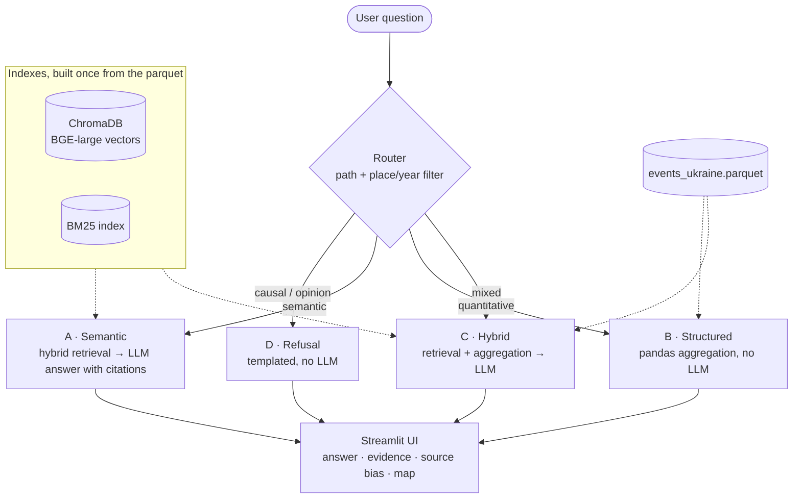

# rag-ucdp

Question answering over conflict-event data: a routed hybrid RAG system on the [UCDP Georeferenced Event Dataset](https://ucdp.uu.se/), with exact aggregation for numeric questions, source-bias surfacing and map views. Scoped to Ukraine 2022–2024 (28,531 events).

[](https://github.com/floew2/rag-ucdp/actions/workflows/ci.yml) [](#quick-start) [](#license) [](#data-and-citation)


**Built with:** BGE-large-en-v1.5 · ChromaDB · BM25 (`rank_bm25`) · Reciprocal Rank Fusion · Ollama (Mistral 7B, local) · pandas · Streamlit · Folium · Python 3.12 · uv · ruff · mypy · pytest

## What it does

UCDP records every event with structured fields (date, place, parties, fatalities) and a short free-text news headline. The structured fields answer *"how many fatalities in Donetsk in 2023?"*; only the text can answer *"attacks on schools"* or *"strikes on power infrastructure"*. This project serves both kinds of question from one interface and uses the LLM only where it adds value.

- **Query routing.** A rule-based router sends each query down one of four paths: semantic search with an LLM answer, exact pandas aggregation without any LLM, a hybrid of both, or a templated refusal for causal and opinion questions.
- **Hybrid retrieval.** Dense (BGE) and keyword (BM25) search, fused with Reciprocal Rank Fusion. Place and year filters extracted from the question pre-filter both legs.
- **Cited answers.** The local LLM answers only from retrieved events and cites them as `[event-ID]`.
- **Source-bias surfacing.** Each result set shows which kinds of outlets reported it (e.g. Russian state media, Ukrainian casualty trackers, OSINT volunteers), with a Simpson diversity index and a single-source dominance flag.
- **Maps.** Retrieved UCDP events are drawn on an interactive Folium map.

## Results

Each component is evaluated on hand-labelled test sets.

| Component | Metric | Result | n |
|---|---|---|---|
| Router | accuracy · macro-F1 | 0.84 · 0.85 | 50 queries |
| Structured aggregation | exact match | 54 / 54 | 54 queries |
| Retrieval (default hybrid) | HR@10 · MRR@10 · nDCG@10 | 0.90 · 0.69 · 0.60 | 30 queries |
| Answer generation | semantic answer similarity · citation faithfulness | 0.74 · 1.00 | 20 queries |

Retrieval is scored against a pooled relevance set: candidates from five different retrieval methods (BM25, dense, RRF, HyDE, multi-query) were labelled with graded relevance, so the labels do not depend on the default system's own ranking. Labels are by the author, LLM-assisted. Generation was measured with `llama3.2:3b` as the answer model.

**Which retrieval upgrades pay off** (same 30 queries and labels, top 10):

| Configuration | HR | MRR | nDCG | Recall | R-Precision |
|---|---|---|---|---|---|
| Hybrid BM25 + dense, RRF (default) | 0.90 | 0.69 | 0.60 | 0.46 | 0.47 |
| + multi-query expansion (Mistral 7B variants) | **0.93** | **0.73** | **0.64** | **0.49** | 0.51 |
| + multi-query + cross-encoder (MiniLM-L-6) | 0.90 | 0.68 | 0.60 | 0.47 | **0.53** |
| + multi-query + cross-encoder (bge-reranker-large) | 0.83 | 0.57 | 0.51 | 0.42 | 0.44 |

- **Multi-query expansion helps modestly** on every metric (implemented in `query_expansion.py`).
- **Cross-encoder reranking hurts** on this data, and the larger reranker hurts more. UCDP records are short and formulaic, which off-the-shelf rerankers score poorly. Reranking was therefore left out for the moment.
- **Recall is the open problem.** At k=10 the default retriever finds about half of all relevant events. Questions phrased without the words the records use (e.g. *"civilians sheltering"* instead of the building's name) are the main failure mode.

The test sets and labels are kept private; the evaluation code is in [`src/rag_ucdp/evaluation.py`](src/rag_ucdp/evaluation.py).

## How it works

The router classifies each question (query) and extracts place and year filters; the same filter drives ChromaDB, BM25 and pandas.



**Router.** First match wins: refusal keywords → path D; aggregation keywords plus a semantic concept → path C; aggregation keywords alone → path B; everything else → path A. Keyword lists live in `router.py`, so every routing decision can be traced to a rule.

**Hybrid retrieval.** The question is embedded with BGE-large-en-v1.5 and searched in ChromaDB, and tokenised and scored with BM25. Both legs are pre-filtered to the extracted place and year, take their top 20, and are fused with Reciprocal Rank Fusion (k = 60). The top 5 events go into the prompt.

**BM25 preprocessing** is lowercase plus regex tokenisation. Stemming, stopword removal and alias folding were tested and did not improve retrieval, so they are off by default (flags in `bm25_index.py`).

## Quick start

**Prerequisites:** Python 3.12, [uv](https://github.com/astral-sh/uv), and [Ollama](https://ollama.com) with the answer model pulled.

```bash
ollama pull mistral:7b
git clone https://github.com/floew2/rag-ucdp.git
cd rag-ucdp
uv sync
```

**Build the indexes (once).** Run `notebooks/02_indexing.ipynb`. It embeds the 28,531 events with BGE-large into `data/chroma_db/` and writes the BM25 index to `data/bm25/index.pkl`. The first run downloads the embedding model (about 1.3 GB); on CPU, embedding takes tens of minutes.

**Run the app.**

```bash
uv run streamlit run app/streamlit_app.py
```

**Run the tests** (no Ollama or indexes needed):

```bash
uv run pytest
```

**Configuration** lives in [`config/config.yaml`](config/config.yaml): data paths, scope, retrieval pool sizes, the embedding and answer models, the Ollama URL and the sampling temperature. The environment variable `OLLAMA_BASE_URL` overrides the Ollama URL.

## Repository layout

```
rag-ucdp/
├── app/
│   └── streamlit_app.py        # web UI
├── config/
│   ├── config.yaml             # all runtime settings
│   ├── aliases.yaml            # place-name spelling variants
│   └── source_affiliations.yaml  # outlet → affiliation category
├── data/
│   └── processed/
│       └── events_ukraine.parquet  # UCDP GED 25.1, Ukraine 2022–2024
├── docs/img/                   # README images
├── notebooks/                  # data exploration, indexing, evaluation
├── src/rag_ucdp/
│   ├── router.py               # path classification + filter extraction
│   ├── retrieval.py            # hybrid retrieval (dense + BM25 + RRF)
│   ├── structured_query.py     # pandas aggregation (path B)
│   ├── hybrid_path.py          # retrieval + aggregation (path C)
│   ├── generation.py           # Ollama client, prompt, citation parsing
│   ├── source_bias.py          # affiliation counts, Simpson index
│   ├── maps.py                 # Folium maps
│   ├── query_expansion.py      # multi-query expansion
│   ├── reranking.py            # cross-encoder reranking (evaluated, off)
│   ├── evaluation.py           # metrics for all four components
│   └── …                       # data loading, embeddings, indexes, config
├── tests/                      # pytest suite, runs in ~15 s
├── pyproject.toml · uv.lock
└── .github/workflows/ci.yml    # ruff, mypy, pytest
```

## Limitations

- **Keyword router.** Questions that imply aggregation or opinion without the usual keywords are routed to the semantic path (5 of 15 aggregation and 3 of 12 refusal test queries).
- **Path C counts are not totals.** The hybrid path aggregates over the top 50 retrieved events without a relevance cut-off, so its numbers can over- or under-count. Its event list is still useful as evidence.
- **Administrative filters are strict.** A filter on one oblast drops relevant events coded just across the boundary (e.g. the opposite bank of the Dnipro).
- **Source taxonomy is hand-curated.** 63 classified outlets cover 94 % of the 37,854 source mentions in the corpus; the remaining outlets count as *other / unknown*.
- **Scope.** English embeddings, Ukraine only, small test sets (20–54 queries per component), online map tiles.

## Next steps

- **Agentic routing.** Replace the keyword router with an LLM agent that chooses the path and tools, keeping the rule-based router as an auditable fallback.
- **Multi-query expansion in the app.** It improves every retrieval metric but is not yet wired into the app.
- **Trustworthy path C counts.** Add a relevance step so the hybrid path aggregates only relevant events.
- **Uncertainty in answers.** Report casualty ranges (low / best / high) instead of point figures.
- **Evaluation.** Measure generation with Mistral 7B as the answer model, with repeated runs and a second annotator for the relevance labels.
- **Deployment and scope.** Package the app with Docker and extend to a second conflict.

## Data and citation

The repository includes a Ukraine subset of UCDP GED version 25.1, redistributed under [CC BY 4.0](https://creativecommons.org/licenses/by/4.0/) as permitted by [UCDP](https://ucdp.uu.se/downloads/). Please cite:

- Davies, S., Engström, G., Pettersson, T., & Öberg, M. (2025). Organized violence 1989–2024, and the challenges of identifying civilian victims. *Journal of Peace Research*, 62(4).
- Sundberg, R., & Melander, E. (2013). Introducing the UCDP Georeferenced Event Dataset. *Journal of Peace Research*, 50(4).

UCDP data collection is supported by DEMSCORE (grant 2021-00162).

The data describes lethal violence. This tool is meant for analysis and documentation, not for operational use.

## License

Code: MIT, see [LICENSE](LICENSE). Data: CC BY 4.0, see above.
