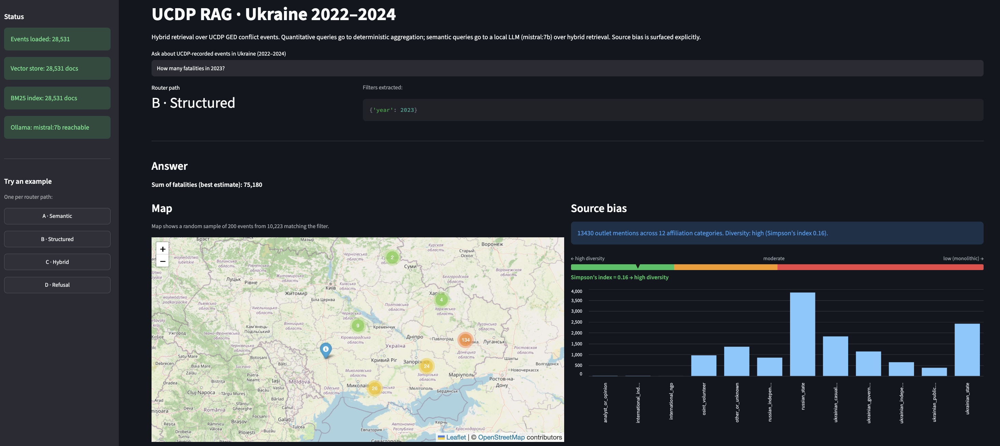
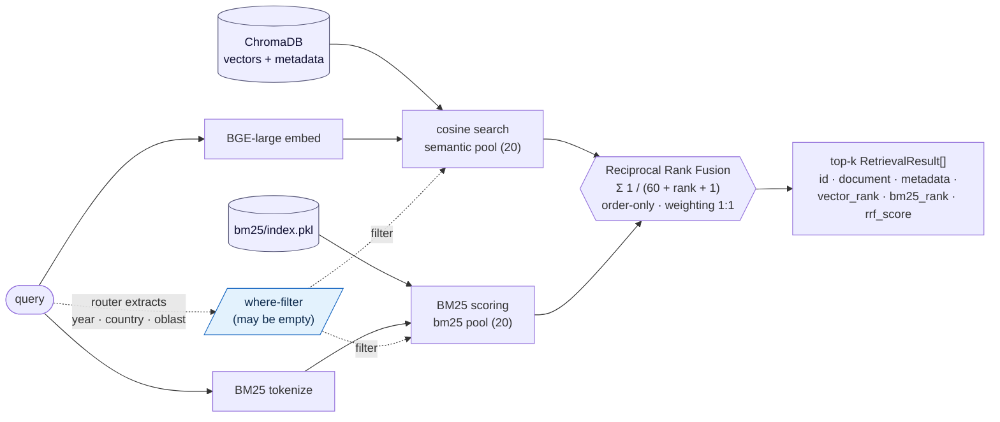
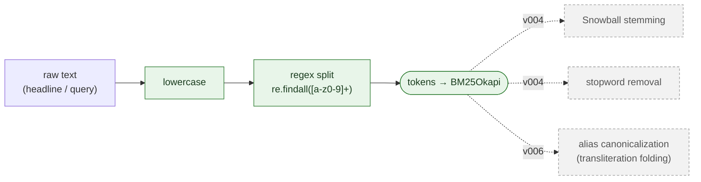

# rag-ucdp

> Routed RAG (Hybrid: BM25 - Semantic - RRF), with a query router at the front of the pipeline. Implemented over the UCDP Georeferenced Event Dataset, with rule-based query routing, source-bias surfacing, and geospatial visualization of retrieved events. Scoped to the Ukraine conflict (2022+, \~28,531 events) and designed for a human-rights NGO context.

[](#tests) [](#prerequisites) [](#license) [](#data-and-citations)

------------------------------------------------------------------------



## What it does

The UCDP Georeferenced Event Dataset is primarily **structured**: every conflict event carries date, coordinates, conflict parties, fatality counts, and categorical fields, all queryable by filter-and-aggregate. What that access pattern *cannot* reach is the **unstructured** `source_headline` field — the news-article text describing named buildings, weapon types, and circumstances that no structured column records.

This project makes that text **semantically searchable**, so an analyst of the NGO can ask *"attacks on schools,"* *"missile strikes on power infrastructure,"* or *"events near religious sites"* and recover relevant events the columns alone could never surface — while still answering numeric questions (*"how many fatalities in Donetsk in 2023?"*) by **exact aggregation**, not LLM guessing. A four-path router decides which question is which, so the LLM is used **only where LLMs are actually strong**.

Key features:

1.  **Query routing** — a four-path rule-based router: semantic → hybrid retrieval + LLM; quantitative → pandas aggregation (no LLM); mixed → hybrid; causal/opinion/moral → templated refusal.
2.  **Source-bias surfacing** (an NGO requirement) — every result set shows per-affiliation counts, a Simpson diversity index, and a single-affiliation dominance flag. Bias is exposed for the reader, not hidden behind an LLM summary.
3.  **Geospatial visualization** (an NGO requirement) — Folium maps overlay retrieved events on Ukrainian territory, making spatial context and cross-border events (Kursk, Belgorod, Poland) visible at a glance.


### Headline metrics (baseline, v010)

| Track | Metric | Test set |
|------------------|----------------------------------|------------------------|
| Router | accuracy 0.840 · macro-F1 0.852 | n=50 |
| Structured | 54/54 exact-match | n=54 |
| Retrieval (hybrid) | [HR\@10](mailto:HR@10){.email} 0.867 · [MRR\@10](mailto:MRR@10){.email} 0.638 · [set-Recall\@10](mailto:set-Recall@10){.email} 0.659 · [set-Recall\@25](mailto:set-Recall@25){.email} 0.802 | n=30 |
| Generation | mean SAS 0.743 · citation faithfulness 1.00 | n=20 |

*Note: v010 is the current baseline. See [Evaluation](#evaluation) and the v009/v010 entries in [`evals/RESULTS_CHANGELOG.md`](./evals/RESULTS_CHANGELOG.md).*

### Stack

BGE-large-en-v1.5 (1024-d, MTEB-top-ranked) · ChromaDB (PersistentClient, cosine) · `rank_bm25` (BM25Okapi) · Reciprocal Rank Fusion (k=60) · llama3.2:3b via Ollama (local, CPU-friendly) · pandas + pyarrow · Streamlit · Folium · Python 3.12 / uv / ruff / mypy / pytest.

------------------------------------------------------------------------

## Architecture

### End-to-end flow

``` mermaid
flowchart TD
    subgraph OFFLINE["Offline indexing — one-time, Colab GPU"]
        direction TB
        CSV["GEDEvent_v25_1.csv"] --> SCOPE["scope filter (offline, one-time)<br/>side_a or side_b = Ukraine<br/>AND date_start in 2022-01-01 … 2024-12-31"]
        SCOPE --> PARQUET[("events_ukraine.parquet<br/>~28,531 events")]
        PARQUET --> DOC["build_document_text()<br/>concatenate UCDP fields into one text:<br/>date · location · parties · type ·<br/>fatalities · headline (trunc. 800)"]
        PARQUET --> META["extract_metadata()<br/>id · year · oblast · lat/lng ·<br/>best · side_a/b · sources"]
        DOC --> EMB["BGE-large embed<br/>raw text · 1024-d · L2-norm"]
        DOC --> TOK["BM25 tokenize<br/>lowercase → regex split [a-z0-9]+<br/>(optional) stopword · stem · alias"]
        EMB --> CHROMA[("ChromaDB<br/>vectors + metadata")]
        META --> CHROMA
        TOK --> BM25IDX[("bm25/index.pkl")]
    end

    CHROMA --> INDEXES["prebuilt indexes<br/>(ChromaDB + BM25)"]
    BM25IDX --> INDEXES

    Q(["User query"]) --> ROUTER{"Router (heuristic)<br/>1 · classify path (strict priority)<br/>2 · query parser → filter extraction"}
    ROUTER -->|"causal / opinion / moral"| D["D · Refusal<br/>templated · NO LLM, NO retrieval"]
    ROUTER -->|"path A / B / C"| WHERE[/"filter extraction (query parser)<br/>where: year · country · oblast<br/>(may be empty)"/]
    WHERE -->|semantic| A["A · Semantic<br/>hybrid retrieval → llama3.2:3b"]
    WHERE -->|quantitative| B["B · Structured<br/>pandas aggregation · NO LLM"]
    WHERE -->|mixed| C["C · Hybrid<br/>retrieval + aggregation → llama3.2:3b"]

    INDEXES -.->|retrieve, filtered| A
    INDEXES -.->|retrieve, filtered| C
    PARQUET -.->|aggregate, filtered| B
    PARQUET -.->|aggregate, filtered| C

    A --> UI["Streamlit UI<br/>router decision · answer · evidence panel ·<br/>source-bias panel · Folium map"]
    B --> UI
    C --> UI
    D --> UI

    classDef store fill:#eef,stroke:#557,color:#113;
    classDef nollm fill:#fff3e0,stroke:#c80,color:#630;
    classDef filt fill:#e3f2fd,stroke:#1565c0,color:#0d2b4d;
    class PARQUET,CHROMA,BM25IDX,INDEXES store;
    class B,D nollm;
    class WHERE filt;
```



### Hybrid retrieval internals (paths A & C)



Both legs draw their candidate pool from a **prebuilt store** — the dense leg from ChromaDB (vectors + metadata), the sparse leg from `bm25/index.pkl` — and the same router-extracted `where` dict **pre-filters both** to in-scope events *before* each ranker selects its top pool. The dense leg filters natively inside ChromaDB; the sparse leg filters by masking BM25 scores to the in-scope id set before truncation (no index rebuild). The identical `where` also drives `structured_query.apply_filters` on path B — **one filter shape, three execution engines**. The filter is a hard pre-scope (exact match on categorical fields); the rankers order only what survives it.

### BM25 tokenization — what ships vs what was tested

The lexical branch is a deliberately minimal baseline. Lowercasing and regex tokenization are the only preprocessing in production; every other standard lever (e.g. stemming, stopword removal) was tested as a single-knob experiment and **not adopted** (full numbers in [`evals/RESULTS_CHANGELOG.md`](./evals/RESULTS_CHANGELOG.md)).



| Lever | Status | Verdict |
|------------------------|------------------------|------------------------|
| Lowercasing | ✅ adopted (baseline) | standard; index/query symmetric |
| Regex tokenize `[a-z0-9]+` | ✅ adopted (baseline) | simple, transparent, fast |
| Snowball stemming | tested (v004) | not adopted — net-negative at k=10; broadens matches but deeper, and nudges top-rank hits down |
| Stopword removal | tested (v004) | not adopted — redundant with BM25's IDF term, which already down-weights high-document-frequency tokens |
| Alias canonicalization | tested (v006) | not adopted **for BM25** — UCDP records already carry both spellings in the same event, so folding adds no matches and slightly perturbs scores. *Adopted for the router*, where it fixes oblast filters (structured 30/30). |

Flags for stemming, stopword removal, and canonicalization remain in `bm25_index.py` (off by default, can be activated anytime), persisted on the index so index-time and query-time tokenization stay symmetric — useful for future NGO data that may lack UCDP's spelling redundancy.

### Router (strict priority — first match wins)

```         
1. REFUSAL keywords present              → Path D (Refusal)
2. AGGREGATION keywords present
     2a. AND semantic concept present    → Path C (Hybrid)
     2b. else                            → Path B (Structured)
3. default                               → Path A (Semantic)
```

Keyword lists are exhaustive and inline in `router.py` so behavior is fully predictable. Filter extraction (year / country / oblast, via a shared canonicalization layer) runs independently of the path choice.

For full keyword lists, the affiliation taxonomy, configuration schema, and component-level detail, see [`PROJECT_SUMMARY_UCDP.md`](./PROJECT_SUMMARY_UCDP.md).

## Quick start

### Prerequisites {#prerequisites}

-   Python 3.12
-   [`uv`](https://github.com/astral-sh/uv) for dependency management
-   [Ollama](https://ollama.com) running locally with the `llama3.2:3b` model pulled

``` bash
ollama pull llama3.2:3b
ollama serve
```

### Installation

``` bash
git clone https://github.com/floew2/rag-ucdp.git
cd rag-ucdp
uv sync
```

### Data and indexing

The UCDP GED v25.1 CSV must be downloaded separately from [ucdp.uu.se/downloads](https://ucdp.uu.se/downloads) (license redistribution constraints) and placed at `data/raw/GEDEvent_v25_1.csv`. The Ukraine-scoped parquet (`data/processed/events_ukraine.parquet`, 3.6 MB) is committed for reproducibility.

Building the ChromaDB + BM25 indexes on Intel Mac CPU is slow (BGE-large's full-corpus embedding needs \~13 GB and OOMs on macOS MPS), so the recommended path is a one-time Colab GPU build:

``` bash
# Open notebooks/colab_indexing.ipynb in Google Colab (T4 GPU, ~1 min),
# download the resulting zip, and extract into:
#   data/chroma_db/
#   data/bm25/index.pkl
```

Both directories are gitignored. The runtime app only embeds **query strings**, which is fast on CPU.

### Running

``` bash
uv run streamlit run app/streamlit_app.py               # demo UI
uv run jupyter notebook notebooks/11_evaluation.ipynb   # four-track eval + ablations
```

### Tests {#tests}

``` bash
uv run pytest                        # full suite (214 tests, <15 s)
uv run pytest tests/test_router.py   # a single file
```

------------------------------------------------------------------------

## Evaluation {#evaluation}

The evaluation is the project's analytical core. Four tracks each target a different component with the metric that fits it: the **router** (classification accuracy / macro-F1), the **structured** path-B aggregation (exact-match), the **retriever** (HR\@k · MRR\@k · set-Recall\@k), and the **generator** (SAS · citation faithfulness). Every test item also carries a **category tag** (e.g. factual, paraphrased, landmark, infrastructure, atrocity, refusal), so each track breaks down per category — which is what turns a single aggregate number into actionable error analysis (the paraphrase regression below was found this way, not in the headline metric).

Each test set has **two tiers**: a curated set (representative use cases, i.e. queries phrased the way a typical analyst would ask, hitting capabilities the system is designed for) and a stress extension (failure-mode probes). Concretely, per track the stress items target:

-   **Retrieval** — paraphrased queries that strip out the exact keywords (the anchor-token problem: "*civilians sheltering*" instead of naming the Drama Theatre), so BM25 has nothing to latch onto.

-   **Router** — queries with implicit intent that dodge the keyword rules: aggregation phrased without aggregation keywords ("*yearly breakdown*"), or refusal-worthy questions without obvious causal/opinion words ("what drove the escalation").

-   **Structured** — edge-case canonicalization (the *Odesa/Bryansk* transliteration mismatches, e.g. a user token is "*odesa*" but the `adm_1` column in UCDP stores that region as "*Odessa oblast*").

-   **Generation** — refusals, hard paraphrases, multi-event synthesis.

**Experiments** in this project were versionized. A **version** (v003, v004, …) is a distinct *system configuration* — a specific set of components and knobs — evaluated against the **same fixed test sets**, so differences between versions reflect the design change, not a change in what's being measured. The full per-version detail (setup, deltas, mechanisms, verdicts) lives in [`evals/RESULTS_CHANGELOG.md`](./evals/RESULTS_CHANGELOG.md).

### Ablation summary — effective top-10 retrieval (Δ vs v003, n=30)

| version | knob changed | HR\@10 | MRR\@10 | set-Rec\@10 | SAS | verdict |
|-----------|-----------|-----------|-----------|-----------|-----------|-----------|
| **v003** | vanilla baseline (hybrid) | 0.867 | 0.622 | 0.686 | 0.715 | reference |
| v004 | BM25 stemming + stopword removal | 0.833 | 0.604 | 0.666 | —ᵃ | not adopted (net-negative) |
| v005 | weighted RRF (sweep) | 0.867 | 0.622 | 0.686 | 0.729ᵇ | not adopted (1:1 is best) |
| v006 | alias canonicalization | 0.867 | 0.622 | 0.677 | 0.729ᵇ | **router fix adopted** (structured 28→30/30); BM25 alias index not adopted |
| v007 | \+ cross-encoder rerank (MiniLM) | 0.833 | 0.653 | 0.655 | —ᶜ | not adopted (paraphrase regressed) |
| v008 | \+ cross-encoder rerank (BGE) | 0.833 | 0.571 | 0.573 | —ᶜ | not adopted (stronger model is worse) |
| **v009** | **filtered harness + BM25 pre-filter (new baseline)** | 0.867 | 0.640 | 0.686 | 0.742 | **adopted** (supersedes v003) |

*SAS is a **generation-track** metric (n=20, separate test set), included here for convenience; it is non-deterministic (temperature \> 0), so cross-version deltas below \~0.02 are sampling noise, not knob effects. ᵃ v004's generation run was void (Ollama down → empty answers); not re-measured. ᵇ within ±0.02 of v003 — generation was unchanged in these retrieval experiments, so the move is context jitter, not signal. ᶜ generation not re-run for the reranker experiments (retrieval-only). The only clean, comparable SAS points are v003 (0.715) and v009 (0.742).*

The Δ-vs-v003 logic above holds for v003–v008, which share one *unfiltered* harness. **v009 is different in kind:** it corrects the harness so evaluation exercises the production *filtered* path (the router's `where` filter was previously inactive in eval), then fixes the three filter bugs that correction exposed — country-from-actor over-reach (now locative-only), the Kyiv city/oblast split (now `$in [oblast, city]`), and the ChromaDB-invalid year-range shape — and moves BM25 from post- to pre-filtering. It is therefore a **new reference point, not a single-knob delta**: [HR\@10](mailto:HR@10){.email}/[set-Recall\@10](mailto:set-Recall@10){.email} are unchanged (most queries carry no filter), [MRR\@10](mailto:MRR@10){.email} improves (+0.018) where filters tighten the in-scope set. v009 established the filtered-path baseline; **v010** then re-evaluates that same configuration under the finalized harness (30/30 candidate pool, structured set expanded to 54) and is the current headline baseline — retrieval logic is unchanged from v009, so the small set-Recall / MRR shifts are the deeper-pool measurement, not a knob. v003–v008 remain valid relative to each other. Full account — including the *administrative-boundary* limitation it documents — is the v009 entry in [`evals/RESULTS_CHANGELOG.md`](./evals/RESULTS_CHANGELOG.md).

------------------------------------------------------------------------

## Limitations

-   **No LLM-based or semantic router, query expansion, or adopted reranker.** The rule-based router's B-as-A/D-as-A gaps and the tier-4 paraphrase failures remain; query expansion (with an explicit transparency cost) is the documented next lever. Cross-encoder reranking was tested and rejected.
-   **BM25 uses no stemming or stopword removal** — a deliberate baseline; the ablation (v004) showed it nets slightly negative here.
-   **Modest test-set sizes** (n=20–50 per track). Adequate to surface failure modes; not for tight confidence intervals. Single-pass, no cross-validation.
-   **set-Recall is measured against a partially circular gold set.** The gold events were pooled from the retrieval system's own top-k output, so set-Recall is biased optimistic — a relevant event the retriever never surfaces cannot enter the gold. A method-independent rebuild is in progress: candidates pooled across five diverse retrieval arms (BM25, dense, RRF, HyDE, multi-query), blind-labeled, with NGO validation (Cohen's κ) pending — early results quantify the recall headroom the production retriever misses.
-   **Generation eval is path-A-isolated**, by design — it measures LLM quality given retrieved context, not end-to-end routing behavior.
-   **Hard `adm_1` filters exclude across-boundary events.** A metadata filter scoped to one oblast drops genuinely relevant events coded *just across* an administrative line from the queried place — e.g. a ZNPP event coded to the Dnipropetrovsk/Nikopol bank (the Dnipro river is the oblast boundary), or the Krasnodar-side strike on the Kerch bridge. The filter is correct *per its predicate*; the predicate is narrower than user intent. Surfaced and documented in v009 (kept in the gold, not trimmed).
-   **English-only embeddings.** BGE-large-en-v1.5; UCDP headlines are predominantly English but contain transliterated terms whose spelling variants (Odesa/Odessa, Kyiv/Kiev) affect retrieval.
-   **Source-bias taxonomy is hand-curated** (\~963 outlets, 13 categories); new outlets in future UCDP releases need manual classification.
-   **Folium maps use online OSM tiles**; offline operation needs self-hosted tiles. Indexes are built once (Colab) — refreshing for a new UCDP release is a manual notebook step.

------------------------------------------------------------------------

## Repository structure

```         
rag-ucdp/
├── README.md                       ← you are here (portfolio narrative)
├── PROJECT_SUMMARY_UCDP.md         ← deep technical reference
├── pyproject.toml · uv.lock · .pre-commit-config.yaml · .github/workflows/ci.yml · LICENSE
├── config/                         ← config.yaml · aliases.yaml · source_affiliations.yaml
├── data/
│   ├── raw/                        ← gitignored (CSV)
│   ├── processed/events_ukraine.parquet   ← committed, 3.6 MB
│   └── chroma_db/ · bm25/          ← gitignored, Colab-built
├── evals/
│   ├── router · structured · retrieval · generation .yaml   ← two-tier test sets
│   ├── results_v001.json … v011.json                        ← per-version outputs
│   └── RESULTS_CHANGELOG.md                                  ← single-knob ablation log
├── notebooks/                      ← 01_data_exploration · 02_indexing · colab_indexing · 10_hand_labeling · 11_evaluation · 12_pooling
├── notes/anchor-token-finding.md   ← deep dive on the paraphrase failure
├── src/rag_ucdp/                   ← data_loading · preprocessing · embeddings · vector_store ·
│                                     bm25_index · retrieval · router · structured_query · hybrid_path ·
│                                     source_bias · maps · canonicalization · reranking · generation · evaluation
├── app/streamlit_app.py
└── tests/                          ← 214 tests, <15 s
```

------------------------------------------------------------------------

## Data and citations {#data-and-citations}

UCDP GED v25.1, downloaded from [ucdp.uu.se/downloads](https://ucdp.uu.se/downloads) under [CC-BY-4.0](https://creativecommons.org/licenses/by/4.0/). Required citations (verbatim, per UCDP's terms):

-   Davies, S., Engström, G., Pettersson, T., & Öberg, M. (2025). Organized violence 1989–2024, and the challenges of identifying civilian victims. *Journal of Peace Research*, 62(4).
-   Sundberg, R., & Melander, E. (2013). Introducing the UCDP Georeferenced Event Dataset. *Journal of Peace Research*, 50(4).
-   DEMSCORE grant: 2021-00162.

------------------------------------------------------------------------

## Acknowledgments


------------------------------------------------------------------------

## License {#license}

Source code: MIT (see [LICENSE](./LICENSE)). UCDP GED v25.1 data: CC-BY-4.0 (see citations above).

------------------------------------------------------------------------

*For the deepest technical detail — architecture internals, full keyword lists, the affiliation taxonomy, configuration schema, the failure-mode taxonomy, and the full decision log — see [`PROJECT_SUMMARY_UCDP.md`](./PROJECT_SUMMARY_UCDP.md).*
